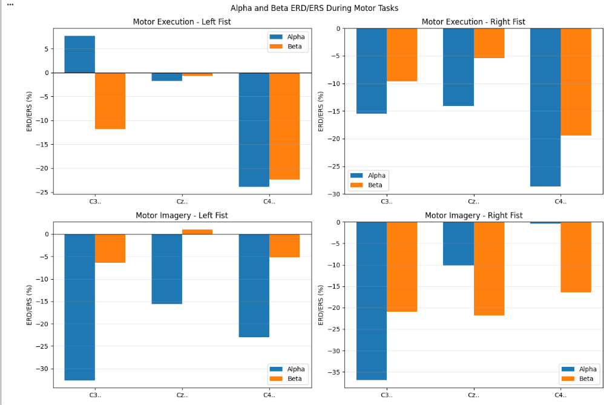
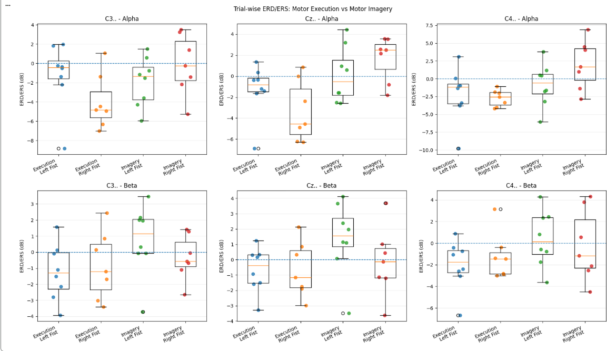
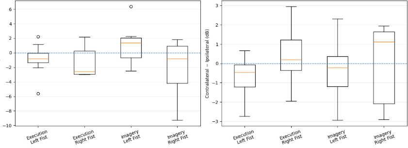

# EEG Analysis of Motor Execution and Motor Imagery

An independent computational neuroscience project comparing sensorimotor EEG activity during **actual** (motor execution) and **imagined** (motor imagery) left- and right-hand movements.

**Author:** Melika B. Vaezi, M.S. student in Kinesiology, Texas Tech University

## Question
Do actual and imagined hand movements produce the same pattern of alpha and beta desynchronization over the contralateral and ipsilateral sensorimotor cortex?

## Data
[PhysioNet EEG Motor Movement/Imagery Dataset](https://physionet.org/content/eegmmidb/1.0.0/), Subject 1:
- Run 3: motor execution (open and close left or right fist)
- Run 4: motor imagery (imagine opening and closing left or right fist)

64-channel EEG, 160 Hz. Raw data are not stored here. The notebook downloads them with `mne.datasets.eegbci.load_data`.

## Methods
1. **Preprocessing (MNE-Python):** 1–40 Hz zero-phase FIR band-pass filter.
2. **Events and epochs:** T0 = rest, T1 = left fist, T2 = right fist. Epochs at sensorimotor channels C3, Cz and C4.
3. **Spectral power:** Welch power spectral density; band power in alpha (8–13 Hz) and beta (13–30 Hz).
4. **ERD/ERS:** percent change in task power relative to a reference period, computed (a) against rest epochs, (b) against each task's preceding rest, and (c) trial by trial against a pre-cue baseline (−2 to 0 s), with the task window 0 to 3.5 s. Negative values = desynchronization (ERD).
5. **Quality check:** trials with extreme ERS (> 100%) were inspected against baseline power and signal amplitude; values were also expressed in decibels, 10·log10(1 + ERD/100), to reduce the influence of extreme ratios.
6. **Lateralization:** for each trial, contralateral channel (C4 for left fist, C3 for right fist) versus ipsilateral channel; lateralization index = contralateral − ipsilateral (dB).

## Results (exploratory, one participant)
- During **motor execution**, alpha ERD was stronger over the contralateral than the ipsilateral hemisphere for both hands (mean alpha ERD, left fist: −2.14 vs −1.21 dB; right fist: −3.98 vs −2.72 dB).
- During **motor imagery**, alpha and beta changes were smaller and the hemispheric pattern was less consistent.
- With 7–8 trials per condition and a single subject, these results are descriptive and not generalizable.

### Figures
Alpha and beta ERD/ERS by condition, hand and channel:



Trial-wise ERD/ERS (dB), motor execution vs motor imagery:



Lateralization (contralateral − ipsilateral, dB):



## How to run
Open `EEG_Motor_Execution_vs_Imagery.ipynb` in Google Colab or Jupyter and run all cells. Locally:
```bash
pip install -r requirements.txt
jupyter notebook EEG_Motor_Execution_vs_Imagery.ipynb
```

## Tools
Python, MNE, NumPy, Pandas, Matplotlib

## Next steps
- Time-frequency analysis of alpha and beta across the trial
- Scalp topographic maps (topomaps)
- More participants, and classification of execution vs imagery
